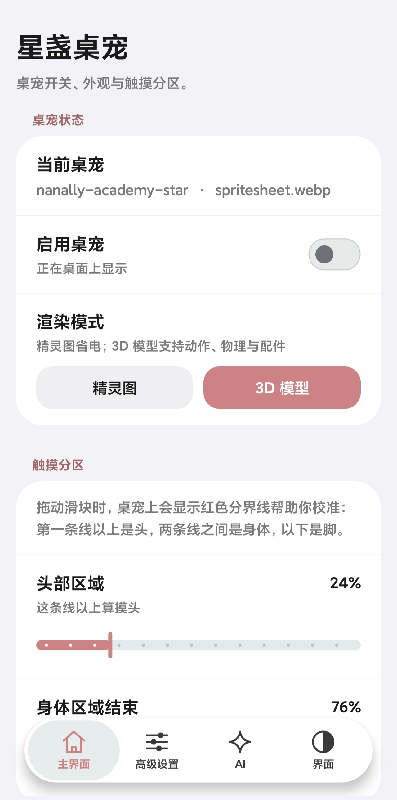
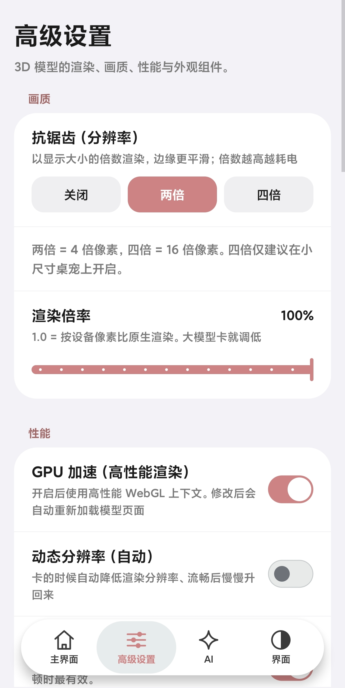
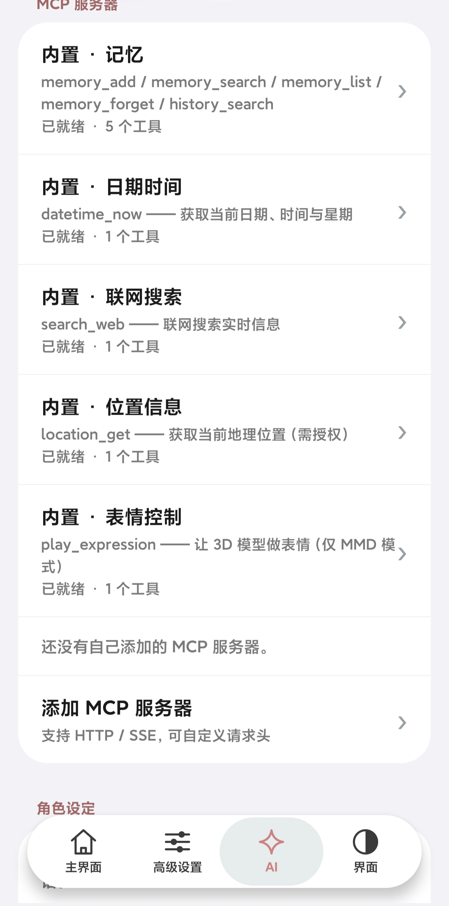
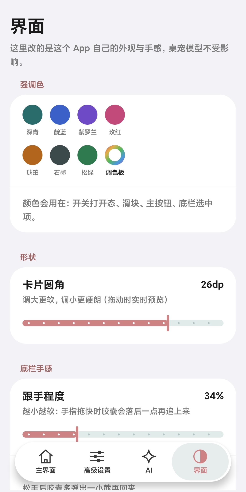

# 星盏桌宠 · StarLamp Pet

一个跑在 Android 桌面上的桌宠 App。支持**精灵图**和 **MMD / glTF 3D 模型**两种渲染模式，
可以用 AI 对话（自带多提供商支持），也支持 **MCP 工具调用**让 AI 真的能操作桌宠（换表情、开配件、播动作）。

纯 Java + 原生 Canvas/WebGL，**不使用 AndroidX / Compose / Material**，
所以体积小、依赖少，一台旧手机也能跑。

---

## 截图

<p align="center">
  
  
  
  
</p>

<p align="center"><sub>主界面 · 高级设置 · AI / MCP · 界面外观</sub></p>


---

## 功能

**桌宠显示**

- 精灵图模式：读取 `spritesheet` 图集，按帧播放动作
- 3D 模式：MMD（`.pmx` / `.pmd`，含 VMD 动作）与 glTF（`.glb` / `.gltf`，用模型自带动画）
- 透明悬浮窗，可拖动、自动贴边、变换大小
- 触摸分区（头 / 身 / 脚），点不同部位给不同反应
- 物理模拟（头发 / 裙子摆动）、动态模糊、自动漫游、抗锯齿与渲染倍率调节

**AI 对话**

- 三击桌宠打开对话面板，支持流式输出
- OpenAI 兼容接口，可配多个提供商（DeepSeek / 硅基流动 / 自建网关…）
- 温度、思考深度可调；支持多轮上下文与长期记忆
- 联网搜索（多家搜索服务商可切）
- 名称翻译：把日文的配件/表情/动作名翻成中文显示（**只改显示，不改数据**）

**MCP 工具调用**

- 内置工具：获取时间、联网搜索、定位、播表情、开关配件
- 也可以连自定义 MCP 服务器（Streamable HTTP + SSE）

---

## ⚠️ 关于素材（务必先读）

**本仓库不包含任何 3D 模型、VMD 动作、贴图素材。**

所有 `.pmx` / `.pmd` / `.glb` / `.gltf` / `.vmd` 都需要**自备**，并且必须遵守原作者的授权条款：

- 模型（尤其是二次元角色模型）通常有明确的「禁止再配布 / 禁止商用 / 需署名」等条款
- MMD 动作文件的作者条款往往写在配布页或 readme 里，**默认不要当成可以随便用**
- 本仓库删掉了开发期使用的示例模型与 13 个内置动作，就是为了避免把别人的素材一起发出去

**首次启动时模型列表是空的**，这是正常的：

```
3D 模型管理 → 导入模型（.zip / .glb）
  · MMD：把 .pmx/.pmd 与它的 textures 目录一起打包成 zip 导入
  · glTF：.glb 是单文件，直接选它
```

没有模型时桌宠只显示一句「还没有 3D 模型」提示，不会崩溃，也**不会挡住屏幕触摸**。

---

## 构建

### 依赖

| 工具 | 说明 |
|---|---|
| JDK 17 | `javac` / `java` |
| Android SDK Platform 33 | 提供 `android.jar`（编译期 stub，33 就够，运行时按 targetSdk 35 处理） |
| Android SDK Build-Tools | `aapt2`、`zipalign`、`apksigner` |
| r8.jar | `d8` 用来把 class 转 dex |
| `zip` | 打包 assets |

**关于 `r8.jar`**：`build.sh` 按下面顺序找它，找到第一个就用：

1. 环境变量 `R8_JAR`
2. **项目根目录的 `./r8.jar`**（最省事：直接把 jar 丢在项目根目录）
3. Android SDK `build-tools/*/lib/d8.jar`

失败时会直接报错并告诉你下载地址（`com.android.tools:r8`），不会静默出半成品。

`android.jar` 也可以覆盖：

```bash
export ANDROID_JAR=/path/to/android-33/android.jar
export R8_JAR=/path/to/r8.jar
```

### 密钥库（仓库不含，需自备）

**本仓库不包含签名密钥**，`keys/` 整个目录都在 `.gitignore` 里。
这是有意的：密钥一旦泄露，任何人都能签出同包名、可覆盖安装的「官方更新包」。

`build.sh` 里也**没有任何口令**，签名口令从环境变量读：

```bash
export PET_KS_PASS='你的密钥库口令'
```

**第一次构建**（从没发布过 APK）自己生成一把，然后立刻备份到仓库外：

```bash
mkdir -p keys
keytool -genkeypair -v -keystore keys/pet.jks -alias pet \
        -keyalg RSA -keysize 2048 -validity 10000 \
        -storepass "$PET_KS_PASS" -keypass "$PET_KS_PASS" \
        -dname "CN=StarLamp Pet"
```

⚠️ **一旦发布过用某个密钥签名的 APK，就必须一直用同一把**，
否则老用户无法覆盖安装（报「签名不一致」）。请把 `keys/pet.jks` 备份到仓库之外。

**只想确认能不能编过**（不需要签名，产物不可安装）：

```bash
SKIP_SIGN=1 PET_KS_PASS=x ./build.sh     # → build/pet-unsigned.apk
```

找不到密钥库时 `build.sh` 会停下来打印上面这两种做法，不会静默重新生成一把
（那样每次构建都换签名，等于把「可覆盖安装」这件事废掉了）。

### 编译

```bash
export PET_KS_PASS='...'
./build.sh
# 产物：build/pet.apk
```

构建脚本会做产物自检（确认 `classes.dex` / `AndroidManifest.xml` / `assets/index.html` 都在），
缺任何一项直接失败 —— 避免拿到一个「构建成功但装不上」的包。

`deploy.sh` / `tools/device-deploy.sh` 是作者在「手机上直接构建并装机」时用的辅助脚本，
需要额外设置 `PET_DEV_ROOT`（设备上的项目目录）。**只在电脑上构建的话完全用不到它们。**

---

## 安装与使用

1. 安装 APK（需要允许「安装未知来源应用」）
2. 首次打开会引导授予 **悬浮窗权限** —— 没有它桌宠显示不出来
3. 「主界面 → 启用桌宠」打开开关
4. 想要 3D：切到「3D 模型」→ 导入自己的模型
5. 想要 AI 对话：「AI」页添加一个提供商（填 Base URL / Key / 模型名）
6. 三击桌宠即可打开对话面板

---

## 权限说明

| 权限 | 用途 |
|---|---|
| `SYSTEM_ALERT_WINDOW` | **必需**。桌宠是一个悬浮窗，没有这个权限无法显示在桌面上 |
| `INTERNET` / `ACCESS_NETWORK_STATE` | 调用 AI 接口、MCP 服务器、联网搜索、翻译 |
| `ACCESS_COARSE_LOCATION` / `ACCESS_FINE_LOCATION` | **可选**。只有内置的「定位」MCP 工具用得到；不给也不影响其他功能 |
| `RECEIVE_BOOT_COMPLETED` | **可选**。开机后自动恢复桌宠（可在设置里关） |
| `VIBRATE` | 长按桌宠时的触感反馈 |

**明文 HTTP 默认关闭**。只对 `127.0.0.1` / `localhost` / `10.0.2.2` 开了白名单
（方便连本机的 Ollama、模拟器连宿主机）。
要连内网 http 服务，请把地址加进 `app/res/xml/network_security_config.xml`。

---

## 已知限制

| 项 | 说明 |
|---|---|
| **全屏眼动追踪不可用** | Android 悬浮窗无法做到「窗口一部分穿透」。全屏窗口一定会挡住其他 App，所以窗口尺寸 = 模型尺寸，眼动只在窗口内跟手 |
| **3D 窗口横向留白** | 窗口是固定宽高比（约 1:1.35），而人物模型通常更高（约 1:2.4）。填满一个方向后另一个方向必然留白 —— 这是窗口形状决定的，不是渲染没铺满 |
| **glTF 描边** | glTF 模型的描边目前是「直接显示源贴图」的近似做法，某些材质下边缘颜色会偏；MMD 路径没有这个问题 |
| 部分生僻名称译不出 | 翻译服务对个别条目会跳过，属正常 |
| 只支持 64 位 ARM 之外的机型也能装，但 | 未在 x86 设备上验证过 WebGL 表现 |

---

## 目录结构

```
app/
├── AndroidManifest.xml
├── res/                        布局 / 图标 / 主题 / 网络安全配置
├── assets/
│   ├── index.html              ★ 3D 渲染与面板的全部前端逻辑（three.js 场景在这里）
│   ├── lib/three/              three.js r150 + MMDLoader / MMDPhysics / GLTFLoader…
│   └── vmd/                    预置动作清单（★ 本仓库为空列表）
└── src/me/rerere/pet/
    ├── MainActivity.java       旧主页（已降级为兜底宿主，禁止新增功能）
    ├── PetApp.java             Application：崩溃兜底 / 首启准备
    ├── core/                   精灵图图集、素材导入、动作语义
    ├── data/                   配置中心 / AI 客户端 / MCP / 翻译 / 模型与动作管理
    └── ui/                     悬浮窗服务、各设置页、自绘控件
lib/*.jar                       androidx.webkit / core / annotation
tools/                          旧主页守卫、设备侧装机脚本
devscripts/                     开发期用过的一次性分析脚本（不参与构建）
```

更细的工程笔记见 [`DEVELOPMENT.md`](DEVELOPMENT.md)。

---

## 许可证

本项目代码以 **MIT** 发布，见 [`LICENSE`](LICENSE)。

- 第三方组件（three.js、Ammo.js、AndroidX…）的许可见 [`docs/THIRD_PARTY.md`](docs/THIRD_PARTY.md)
- **应用图标是占位图**（`app/res/drawable/ic_launcher_placeholder.xml`，矢量绘制，无版权问题）。
  仓库不附带任何美术素材，换成自己的图标见 [`docs/ICON.md`](docs/ICON.md)
- 仓库内不含任何模型/动作素材，自备素材的版权由使用者自行负责
